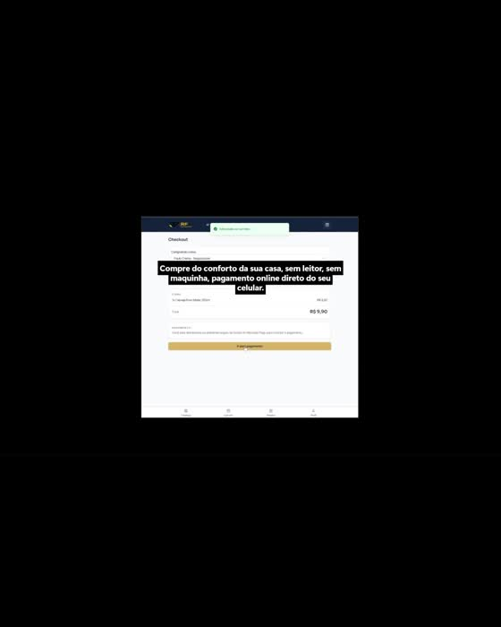

# RF WALLMARKET Purchase Core

C++20 purchase engine based on the family, age restriction and checkout flow shown in `sistemacompra(1).mp4`.

## Capabilities

- Household and QR unit checks at the domain boundary.
- Owner email verification policy and minor PIN verification policy.
- Restricted product blocking for minors and unverified adults.
- Integer currency calculations and immutable order price snapshots.
- Atomic cart reservation, stock restoration on expiry and idempotency conflict detection.
- Payment verification interface, receipt reuse protection and collection state transitions.
- Repository contract with all-or-nothing commits.

## Build and run

Linux, GCC 12 or newer, GNU Make.

```sh
make all test
./build/market
```

```text
product water unit-1 990 20 0
product wine unit-1 3000 4 1
reserve owner-1 home-1 unit-1 1 1 unit-1 request-1 1800000000 water 2
stock water
audit
expire 1800000300
stock water
quit
```

All prices are integer cents. The terminal is a local developer tool; its verification flags are explicit inputs. Production callers must construct `Principal` from trusted authentication and verification results. The library does not send confirmation emails, store PINs, authenticate users, process bank transfers or provide a payment gateway.

## Integration

Use `Checkout::reserve`, `pay` and `collect` from a trusted service. Implement `PaymentVerifier` using a real provider and verify order identity, amount, currency, merchant and settlement status. The included executable exposes reservations, expiry and audit inspection only.

State is held in memory. No database dependency, database account or credentials are included. Future adapter contract: [docs/persistence.md](docs/persistence.md).

## Validation

Tests cover unit isolation, restricted products, insufficient stock rollback, immutable totals, idempotent requests, ownership, payment rejection, collection, expiry, repository failure and concurrent reservations without overselling.

## Video evidence

[](evidence/demo.mp4)

[Open the original demonstration](evidence/demo.mp4)

The video demonstrates the author's reference system. This repository implements its observed purchase rules in C++; it does not reproduce the original web application. The recording is not a test run of this implementation. Original filename and SHA-256: [evidence/provenance.json](evidence/provenance.json).

## Credits and license

Created for [brunnodev.store](https://brunnodev.store/). MIT: [LICENSE](LICENSE).
